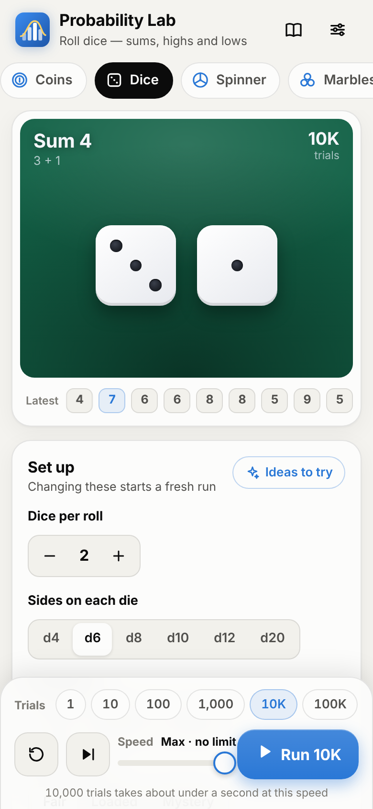
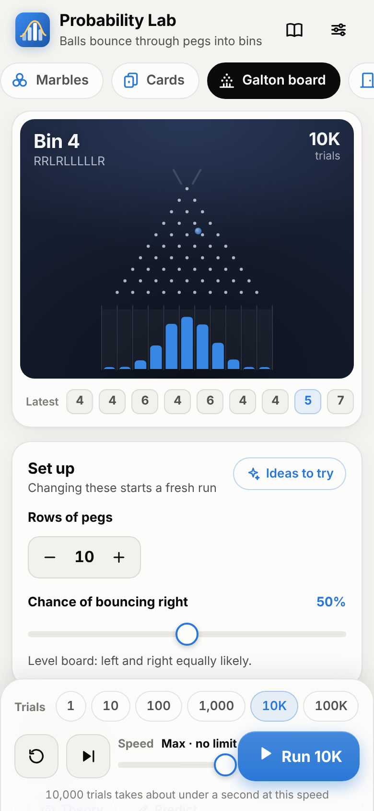
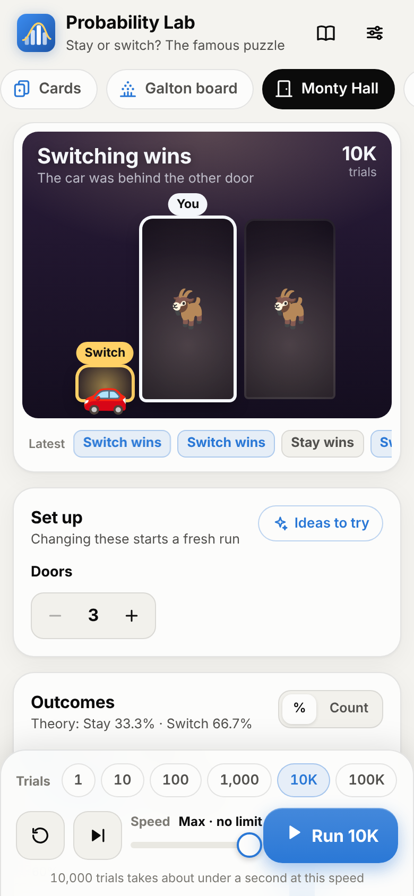
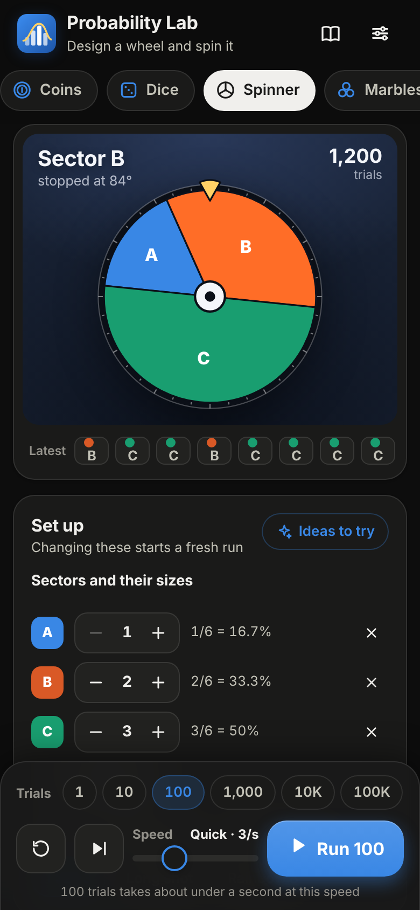
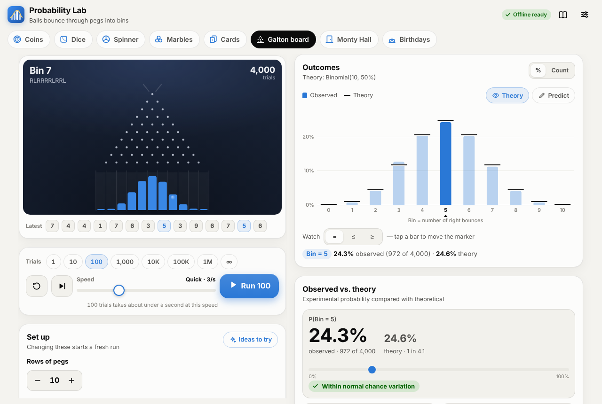

# Probability Lab

An offline mobile app for building probability intuition by experiment. Roll dice, flip coins,
spin spinners, draw marbles and cards, drop balls through a Galton board, play Monty Hall and
test the birthday problem. Watch a live histogram grow as trials run, and compare it with the
theoretical probability.

It runs fully offline as an installable web app (PWA) and as a native Android app (Capacitor).
It has no accounts, no tracking and no network calls.

<p>
  
  
  
  
</p>


## Install

| Where | How |
|---|---|
| **Android (native)** | Download [`dist/ProbabilityLab-1.0.0-debug.apk`](dist/ProbabilityLab-1.0.0-debug.apk) on the phone, open it and allow installing from this source. |
| **Any phone (PWA)** | Host the `www/` folder on any static host (GitHub Pages, Netlify, a school server). Open it once, then use **Add to Home Screen** (iOS Safari: Share → Add to Home Screen). After the first visit it works with no connection. |
| **On a computer** | `npm start`, then open <http://localhost:8080>. |

## What's inside

### Eight experiments

Each one simulates the real mechanism: it flips every coin, draws from a real shuffled deck and
plays each Monty Hall game. It never samples from the answer, so comparing the results with the
theory is a real test.

| Mode | Setup options | Theory |
|---|---|---|
| **Coins** | 1–12 coins, any bias | Binomial; longest-streak tracker (gambler's fallacy) |
| **Dice** | 1–6 dice, d4–d20, sum / highest / lowest, fair / loaded / **mystery** | Exact convolution; max/min via CDFs |
| **Spinner** | 2–8 sectors with editable sizes, presets | Angle share (geometric probability) |
| **Marbles** | Up to 12 each of 3 colours, 1–8 draws, with/without replacement | Binomial vs. hypergeometric |
| **Cards** | Suit, colour, rank, card kind, or 5-card poker hand | Counting; all 2,598,960 hands verified in tests |
| **Galton board** | 2–16 rows, tilt | Binomial / Pascal's triangle |
| **Monty Hall** | 3–8 doors, host opens all-but-one or just one | 1/n vs. (n−1)/n, and the general case |
| **Birthdays** | 2–100 people; days, months or weekdays | 1 − ∏(d−i)/d |

### Running trials

- **Trial counts:** 1, 10, 100, 1K, 10K, 100K, 1M, or ∞ (runs until you pause).
- **8 speeds**, from *Slow* (each trial acted out, about 2 s each) to *Max* (millions per second).
  At animated speeds a bar only grows when the trial you just watched lands. At streaming speeds
  the stage shows a sample a few times a second (throttled so nothing flashes) while the
  histogram updates every frame.
- **Pause, resume, step one trial, reset.** Reset and setup changes can be undone.
- The dock estimates how long a run will take, and offers to go faster if it would take more
  than 3 minutes.

### Seeing the comparison

- **Live histogram.** Observed bars grow smoothly. A black mark on each bar shows the theory.
  You can switch between % and counts, and hide the theory.
- **Watch an event.** Tap bars to choose an event. Numeric outcomes support `=`, `≤` and `≥`
  (for example "Sum ≥ 9"). Categorical outcomes support one outcome or a combination
  (for example "♥ or ♦").
- **Observed vs. theory panel:**
  - observed vs. theoretical probability, shown as a fraction and as "1 in N"
  - a number line with the 95% range for the current sample size
  - the gap in percentage points, with the typical gap for that many trials
  - a plain-language verdict: "Within normal chance variation" or "Unusual"
  - observed vs. expected mean and standard deviation
  - a chi-square check on the whole shape of the distribution, which pools cells automatically
    and explains the result in words
- **"Does it settle down?"**: the running percentage on a log trial axis, inside the
  p ± 1.96·√(p(1−p)/n) funnel. This is the Law of Large Numbers.
- **Predict first.** Sketch your guess on the histogram by dragging (theory and results are
  hidden while you sketch). After the run, your guess is scored against both the theory and
  your results.
- **Data table** with CSV export or copy, for spreadsheets.

### Teaching support

- A **Learn** sheet for every experiment: the big idea, the theory, a common misconception,
  and **Try this** presets that set up a ready-made investigation.
- **Basics**: theoretical vs. experimental probability, the Law of Large Numbers, variability,
  independence, distributions, expected value and fit checks.
- A **fixed random seed** (Settings). Everyone using the same seed gets exactly the same results,
  which is good for whole-class discussion. Reset replays the same sequence.
- **Mystery dice**: the theory assumes fair dice, but the dice may be secretly loaded. Students
  gather evidence and use the fit check before pressing **Reveal**.

### App qualities

- Fully offline: the service worker precaches every file, and the Android app bundles them.
- Light and dark themes, each with its own colours (not an automatic inversion).
- The chart palette is colourblind-checked, and colour never carries meaning on its own.
- Reduce-motion support, screen-reader announcements, keyboard shortcuts
  (<kbd>Space</kbd> run/pause, <kbd>S</kbd> step, <kbd>R</kbd> reset, arrows move the bar
  selection).
- Optional synthesized sound effects (no audio files) and haptics.
- Phone layout with a thumb-reach control dock; two-column layout on tablets and desktops.
- Safe-area aware, including Android edge-to-edge.

## Classroom ideas

1. **Small vs. large samples.** Flip 1 coin 10 times and record the % heads. Then run 10,000.
   Which is closer to 50%? Use the convergence chart to explain why.
2. **Why 7?** Have students predict the 2-dice sum histogram with *Predict*, then run 3,600 rolls
   and compare.
3. **Is it rigged?** Use *Mystery* dice. How many rolls before the fit check is convinced? Do
   different groups agree?
4. **Monty Hall debate.** Take a vote, play 10 slow games, then 10,000 at Max.
5. **Birthday bet.** Find the smallest room where a match is more likely than not. Compare with
   your own class size.

## Development

There is no build step. The app is plain ES modules in `www/`.

```
www/
  index.html, css/app.css, manifest.webmanifest, sw.js, icons/
  js/core/         rng (seedable sfc32), prob (exact distributions, chi-square),
                   results (tallies + convergence snapshots), runner (speed control), events
  js/experiments/  one file per mode: controls, theory, simulation, lesson content
  js/stages/       one animated stage per mode (DOM/SVG/canvas)
  js/ui/           histogram, convergence chart, controls, sheets, learn content, sound
scripts/           serve, build-sw (precache list), e2e, make-icons
tests/             node:test unit tests
android/           Capacitor Android project
```

```bash
npm install          # Capacitor tooling (only needed for Android)
npm start            # http://localhost:8080
npm test             # 54 unit tests: math, every experiment vs. its theory, full poker enumeration
npm run test:e2e     # browser tests at phone size, including an offline reload (needs Playwright)
npm run build        # regenerate the service worker's precache list after editing www/
npm run check        # verify the precache list is current + unit tests
```

After changing anything in `www/`, run `npm run build` so installed copies pick up the new
version. `npm run check` fails if you forget.

### Building the Android app

Requirements: JDK 21 and the Android SDK (platform 36). Android Studio provides both.

```bash
npm install
npm run android:build   # → android/app/build/outputs/apk/debug/app-debug.apk
npm run android:open    # or open in Android Studio to run on a device/emulator
```

For a Play Store release, create a signing key and run `./gradlew bundleRelease` in
`android/`. See the Capacitor docs on publishing. App id: `io.github.samplatypus.probabilitylab`.

CI (`.github/workflows/ci.yml`) runs the unit and browser tests and uploads a debug APK on every
push.

## How the simulation stays honest

- **The mechanism, not the answer.** Each experiment's `sample()` acts out the physical process.
  For example, the spinner draws a uniform random angle and finds the sector it lands in. The
  theory is computed separately and exactly.
- **Two code paths, both tested.** Fast runs use an allocation-free `sample()`; animated runs use
  `trial()`, which returns details for the animation. Unit tests check both against the theory
  with chi-square tests over 60,000+ trials for 35 configurations.
- **Counted when it lands.** In animated modes a result is added to the histogram only when its
  animation finishes. Cancelled animations (reset, setup change) are discarded by a generation
  counter, so they are never double-counted.
- **Unbiased randomness.** sfc32 PRNG seeded from `crypto.getRandomValues`, with rejection
  sampling for integers (no modulo bias).
